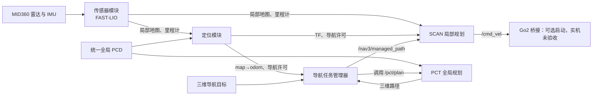

# Nav3 主仓库架构与联调进度说明

汇报日期：2026 年 11 月 17 日

## 一、项目目标与当前结论

Nav3 面向室内三维环境，目标是把 MID360 雷达与 IMU 的实时感知、全局定位、三维路径规划、局部轨迹生成和速度控制连接起来。系统基于 ROS 2 Humble，四个导航模块与一个待接入的 Go2 底盘模块独立维护；主仓库负责固定模块版本、统一地图与启动配置，并管理一次导航任务。

**当前已经完成四模块独立启动和无雷达输入条件下的联合启动；实体雷达至 FAST-LIO 的数据链路及 PCT 在统一地图上的一次实际规划也已验证。实体雷达下的首次全局定位、真实路径进入 SCAN 后的执行链路尚未完成，因此目前不能称为整机自主导航已通过验收。**

## 二、主仓库如何组织系统

主仓库的目录结构如下。四个导航模块与底盘模块位于 `modules/`，跨模块的任务管理和统一启动代码位于主仓库的 `src/`。

```text
Nav3_ws/
├── .gitmodules                    # 五个子模块的仓库地址
├── modules/
│   ├── Nav3_Sensor_ws/           # MID360、FAST-LIO、局部地图
│   ├── Nav3_Localization_ws/     # 全局定位与导航许可
│   ├── Nav3_Global_planner_ws/   # PCT 三维全局规划
│   ├── Nav3_Local_Planner_ws/    # SCAN 局部规划与控制
│   └── Nav3_Chassis_ws/          # Go2 速度桥接，可选联合启动
├── src/
│   ├── nav3_bringup/             # 联合启动与参数衔接
│   └── nav3_navigation_manager/  # 导航目标与任务状态管理
├── scripts/                      # 工程辅助脚本
├── data/
│   ├── maps/                     # 本机全局地图与派生数据
│   └── bags/                     # 本机回放数据
└── report/                       # 联调记录与说明材料
```

| 位置 | 内容与职责 |
| --- | --- |
| `modules/Nav3_Sensor_ws` | Livox MID360 驱动、FAST-LIO 和滑动窗口局部地图。输出点云、IMU、里程计、局部地图及健康状态。 |
| `modules/Nav3_Localization_ws` | 将局部地图与全局参考地图配准，维护 `map → odom`，发布定位结果和持续导航许可。 |
| `modules/Nav3_Global_planner_ws` | PCT 根据全局 PCD 构造三维代价地图，按起终点规划全局路径。 |
| `modules/Nav3_Local_Planner_ws` | SCAN 根据里程计、局部地图和全局路径生成局部轨迹与 `/cmd_vel`。 |
| `modules/Nav3_Chassis_ws` | Go2 底盘速度桥接；已作为独立子模块纳入仓库，可在统一启动中选择空跑或连接实机，实机联调尚未完成。 |
| `src/nav3_navigation_manager` | 接收三维导航目标，调用 PCT，向 SCAN 发布受管理路径，监控任务完成、失败与取消。 |
| `src/nav3_bringup` | 启动四个导航模块与任务管理器，可选启动底盘桥接；传入统一地图、区域候选和接口参数，并先完成 PCT 地图预热。 |
| `scripts/`、`data/`、`report/` | 分别保存工程辅助脚本、本机地图与回放数据、联调证据和问题记录。 |

五个 `modules/` 目录是独立 Git 仓库，以子模块形式纳入主仓库。主仓库记录每个模块的**具体提交版本**，因此模块负责人可以独立更新；只有主仓库完成联调并更新子模块指针后，新模块版本才进入整机基线。团队交接方式见[模块协作与主仓库联调流程](Nav3模块协作与主仓库联调流程.md)。

## 三、导航数据链路与模块边界



核心坐标链为 `map → odom → base_link → lidar`：定位确定机器人相对于全局地图的位置，FAST-LIO 提供连续的局部运动估计。主仓库统一使用 `data/maps/building_split_space.pcd` 作为定位与 PCT 的全局参考地图。该约 880 MiB 地图存放在本机，不纳入 Git；`space_2` 的首次定位候选与它的 SHA-256 一致。启动时可通过 `initial_region` 选择区域，默认 `space_2`；选择其他区域不会沿用 `space_2` 候选。

主要跨模块接口如下：

| 接口 | 类型 | 作用 |
| --- | --- | --- |
| `/fast_lio/odom`、`/fast_lio/local_map` | `Odometry`、`PointCloud2` | 提供局部运动与滑动窗口地图，供定位和 SCAN 使用。 |
| `/localization/status`、`/localization/navigation_allowed` | `LocalizationResult`、`Bool` | 区分匹配与已应用的定位结果，并持续决定是否允许导航。 |
| `/pct/plan` | `Plan` Service | 接收 `map` 中的起终点，返回三维全局路径。 |
| `/nav3/navigate_to_pose` | `NavigateToPose` Action | 接收一次 `map` 中的三维导航目标并反馈任务状态。 |
| `/nav3/managed_path` | `Path` | 管理器向 SCAN 发送当前任务路径；空路径用于撤销任务。 |
| `/scan_planner/status`、`/scan_planner/execution_state` | `PlannerStatus`、`ExecutionState` | 供管理器识别当前路径的规划与跟踪状态。 |
| `/cmd_vel` | `Twist` | SCAN 输出平面速度；Go2 桥接可选订阅，已完成空跑接口核对。 |

bringup 首先检查地图与定位候选，启动各节点，并在 PCT 地图准备成功后启动任务管理器。管理器仍须等待定位许可、有效 TF、PCT 服务和 SCAN 状态满足条件，才接受目标；启动文件运行不等于导航已经就绪。目标到达、取消或故障时，管理器撤销受管理路径。第一版暂不执行终点朝向调整，也不自动反复重规划。

## 四、联调进度与证据边界

| 项目 | 已完成的验证 | 尚未得到的结论 |
| --- | --- | --- |
| 传感器 | 实体 MID360 测得点云与里程计约 10 Hz、IMU 约 200 Hz、局部地图约 1 Hz，健康状态为正常。 | 运动条件下的里程计精度和长期稳定性未验收。 |
| 定位 | 完整地图可加载；无有效输入时导航许可为 `false`，禁止导航。 | 实体数据下首次定位 `applied=true`、`map → odom` 和许可变为 `true` 尚未实测。 |
| 全局规划 | RTX 4060 上已对统一地图生成 12 层、2,023,632 个代价单元，并从缓存规划出一条 10 位姿测试路径。 | 多楼层路径、资源峰值及与现场机器人位置的几何对齐未验收。 |
| 任务管理 | 隔离环境模拟成功、取消、规划失败、定位许可撤销、未就绪拒绝、控制器未跟踪六种任务情况。 | 尚未用真实定位和 SCAN 状态完成一次目标执行。 |
| 统一启动 | 四个导航模块同域启动；PCT 使用统一地图并预热成功；无输入时管理器保持 `WAITING`、`/cmd_vel` 为零；区域从 `space_2` 切换到 `space_3` 的参数与订阅已核对。Go2 桥接空跑启动，`/cmd_vel` 发布订阅与 QoS 已核对。 | 没有实体雷达输入时无法验证首次定位和完整闭环；未连接实机底盘。 |

详细的测试过程、数值和日志结论见[联调记录](联调记录.md)。上述各项属于不同阶段的验证，尚未在一次实体实验中串成完整导航任务。

## 五、下一阶段工作

1. 解决雷达配置要求的主机 `192.168.1.5` 与本机 `eno2` 持久地址 `192.168.123.5/24` 不一致的问题，恢复可重复的实体雷达启动。
2. 在实体 MID360 输入下验证首次定位、`map → odom`、导航许可，以及定位失效后的撤销行为。
3. 在同一 ROS 域发送三维目标，检查 PCT 路径经任务管理器进入 SCAN，验证轨迹、任务状态、取消和 `/cmd_vel`；先维持底盘空跑。
4. 实机接入前，核对机器人控制参考点、速度方向和底盘命令超时停车机制，并处理管理器进程失联时的路径保护。

主仓库使用入口及更完整的参数和消息说明见[README](../README.md)与[bringup 说明](../src/nav3_bringup/README.md)。
